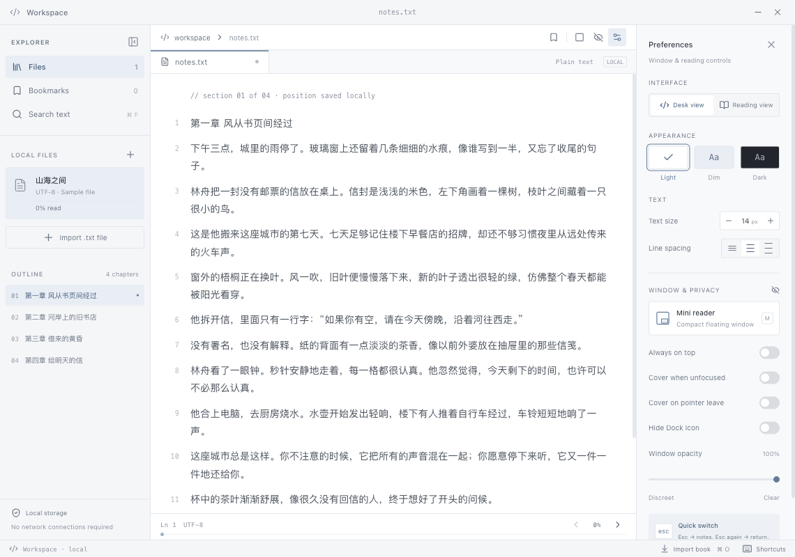

# Margin · 余白

**桌面留一点空白，故事读到下一页。**

[English](README.md) · [下载最新版](https://github.com/OWNER/margin-reader/releases/latest) · [更新记录](CHANGELOG.md) · [参与贡献](CONTRIBUTING.md)

余白是一款小巧、离线的 TXT 小说阅读器，专为中文阅读和桌面上的片刻休息而做。默认的 **Desk view（工作台视图）** 使用普通的 `notes.txt` 标签、行号和简洁控件，看起来像一个文本工具。把它放在屏幕角落，随时接着读；按一下 `Esc`，就能切换到自己的笔记。



## 功能

- **小窗阅读：** 默认 360 × 320 像素，可拖动、缩放，支持窗口置顶和透明度调节。
- **低调的工作台：** 中性的窗口标题和文件标签；一键切换笔记，可选失焦遮盖、鼠标离开遮盖。
- **适配中文小说：** UTF-8、GB18030/GBK、Big5、UTF-16 编码；自动识别章节，乱码时可手动选择编码。
- **随时接着读：** 本地书架、书签、全文搜索、章节目录，自动保存阅读位置。
- **舒适阅读：** 可切换到更宽松的 Reading view（阅读视图）；三种主题、字号和行距调整，阅读视图提供宋体/黑体风格。
- **完全本地：** 无需注册，无上传、统计分析或云服务，阅读时无需联网。

<p align="center">
  
</p>

## 下载与安装

前往[最新 Release](https://github.com/OWNER/margin-reader/releases/latest)，在 **Assets** 中下载适合你电脑的安装包。**无需安装 Node.js 或 npm。** GitHub 自动生成的 “Source code” 是源码，不是可直接运行的应用。

| 电脑类型                           | 下载文件                        |
| ---------------------------------- | ------------------------------- |
| Apple Silicon Mac（M1 及更新芯片） | `Margin-1.1.0-macos-arm64.zip`  |
| Intel Mac                          | `Margin-1.1.0-macos-x64.zip`    |
| Windows，Intel/AMD 64 位           | `Margin-1.1.0-windows-x64.zip`  |
| Linux，Intel/AMD 64 位             | `Margin-1.1.0-linux-x64.tar.gz` |

请以 Release 页面上的版本号和文件名为准。发布包附带 SHA-256 校验值。macOS Apple Silicon 已在本地验证；其他平台由 GitHub Actions 构建。Linux 的部分窗口功能取决于桌面环境，详见下方说明。

**macOS：** 解压后将 `Margin.app` 拖到“应用程序”文件夹，再打开。当前版本未使用 Developer ID 签名，也未经过 Apple 公证。如系统阻止运行，先尝试打开一次，再进入 **系统设置 → 隐私与安全性 → 仍要打开**，为 Margin 单独放行。参见 [Apple 官方说明](https://support.apple.com/zh-cn/102445)。

**Windows：** 将整个 ZIP 解压到一个文件夹，运行其中的 `Margin.exe`。请保留同目录下的所有文件。当前版本没有代码签名，系统可能提示发布者未知；无需运行安装程序。

**Linux：** 解压后运行文件夹中的 `Margin`。需要图形桌面、Electron 所需系统依赖和中文字体。例如：

```sh
tar -xzf Margin-1.1.0-linux-x64.tar.gz
cd Margin-linux-x64
./Margin
```

## 开始阅读

1. 点击 **Import .txt file**，按 `⌘O` / `Ctrl+O`，或将一个或多个 `.txt` 文件拖入窗口。单个文件最大 100 MB。
2. 在左侧目录选择章节，搜索文字，或用底部进度条跳转。阅读位置会自动保存。
3. 按 `M` 切换到迷你窗口。拖动顶部栏移动窗口，拖动边缘调整大小。在 Preferences 中设置置顶、透明度和自动遮盖。
4. 按 `Esc` 显示笔记，再按一次返回阅读。按 `⌘⇧X` / `Ctrl+Shift+X` 可以在其他应用中隐藏或恢复整个阅读器。

应用内置一篇原创中文故事《山海之间》，可以直接试读。**目前界面标签以英文为主**；中文正文、文件名、搜索和章节标题均受支持。

### 乱码与章节

自动检测会优先识别 Unicode 字节顺序标记和有效 UTF-8，再尝试区分 GB18030 与 Big5。若出现乱码，在导入对话框中手动选择 **GBK** 或 **Big5**，重新导入原文件。重新导入会创建新的书架条目，之后可删除乱码的条目。原始 TXT 文件不会被修改。

`第一章`、`第二回`、`楔子`、`尾声` 等中文标题以及英文章节标题会自动生成目录。没有标题的文件仍可作为一个章节阅读。特别长的章节会分段显示，点击 **Next section** 继续当前章节。

### 小窗与遮盖

迷你窗口默认 360 × 320 像素，最小 300 × 240 像素。普通窗口和迷你窗口会分别记住大小与位置。在支持的平台上，透明度可调为 35–100%。

**Cover when unfocused（窗口失焦时遮盖）** 与 **Cover on pointer leave（鼠标离开时遮盖）** 默认关闭。触发自动遮盖后，按 `Esc` 或点击 **Return** 才会返回小说；鼠标移回窗口不会自动显示正文。笔记内容也会保存在本地。

macOS 提供 **Hide Dock icon（隐藏 Dock 图标）**，菜单栏入口仍然保留。菜单栏 / 系统托盘还提供显示、隐藏和退出操作；全局快捷键不可用时，可从这里恢复窗口。

<details>
<summary>想要更像书本的阅读体验？展开查看 Reading view。</summary>

在 Preferences 中选择 **Reading view**。两种视图共享阅读进度。


</details>

## 快捷键

| 快捷键                               | 功能                                |
| ------------------------------------ | ----------------------------------- |
| `Esc`                                | 笔记 / 返回阅读；有弹窗时先关闭弹窗 |
| `M`                                  | 迷你窗口 / 展开                     |
| `B`                                  | 在当前段落添加或取消书签            |
| `→` / `←` 或 `Page Down` / `Page Up` | 下一页 / 上一页                     |
| `Space`                              | 下一页                              |
| `↓` / `↑`                            | 向下 / 向上滚动                     |
| `⌘O` / `Ctrl+O`                      | 导入 TXT                            |
| `⌘F` / `Ctrl+F`                      | 搜索当前书籍                        |
| `⌘⇧X` / `Ctrl+Shift+X`               | 全局隐藏 / 恢复应用                 |

在文本框中输入时，单字母阅读快捷键不会触发。

## 本地数据与更新

书籍、书签和进度存放在 IndexedDB 中；偏好设置和笔记使用 local storage；窗口设置保存在 `window-preferences.json`。这些数据位于 Electron 的应用数据目录，通常为：

| 平台    | 数据目录                                                 |
| ------- | -------------------------------------------------------- |
| macOS   | `~/Library/Application Support/Margin`                   |
| Windows | `%APPDATA%\Margin`                                       |
| Linux   | `$XDG_CONFIG_HOME/Margin`，未设置时为 `~/.config/Margin` |

正式应用会阻止远程 HTTP 和 WebSocket 请求。删除书架条目只删除导入的副本和阅读进度，不会删除原始 TXT。请保留原始文件；清理应用数据会移除本地书架。

更新时，先退出余白，再下载新版并替换应用文件。保留上述数据目录，即可保留书架与设置。应用目前没有自动更新功能。浏览器预览、开发版和正式应用可能使用不同的存储空间。

## 平台差异

- **macOS：** 隐藏 Dock 图标仅在 macOS 可用。发布包未经过 Apple 公证。
- **Windows：** 运行时需要完整的解压目录，请勿只复制 `Margin.exe`。
- **Linux：** 透明度、置顶、托盘、窗口定位和全局快捷键受桌面环境影响。Wayland 可能限制窗口控制，或需要全局快捷键 portal；可以使用可用的托盘入口恢复窗口。参见 Electron 的[窗口文档](https://www.electronjs.org/docs/latest/api/browser-window)和[全局快捷键文档](https://www.electronjs.org/docs/latest/api/global-shortcut/)。若中文显示为方块，请通过发行版安装 Noto Sans CJK 等中文字体。
- **浏览器预览：** 支持阅读和浏览器标签内的紧凑布局。独立悬浮窗口、透明度、置顶及全局快捷键需要桌面版。

## 从源码运行

开发需要 **Node.js 24** 和 npm。

```sh
git clone https://github.com/OWNER/margin-reader.git
cd margin-reader
npm ci
npm run dev
```

```sh
npm run build          # 类型检查与前端构建
npm start              # 运行已构建的桌面应用
npm test               # 单元测试
npm run test:e2e        # Electron 集成测试，需先构建
npm run package        # 为当前平台打包应用
npm run release:local  # 打包并生成可分发的压缩文件
```

`npm run dev:web` 只启动浏览器预览。项目使用 React、TypeScript、Vite 和 Electron。集成测试使用临时数据目录，不会改动你的个人书架。

项目结构与发布流程见 [CONTRIBUTING.md](CONTRIBUTING.md)。欢迎提交问题和 Pull Request。

## 许可证

[MIT](LICENSE)。附带的第三方依赖遵循各自的许可证，详见[第三方声明](THIRD_PARTY_NOTICES.md)。
